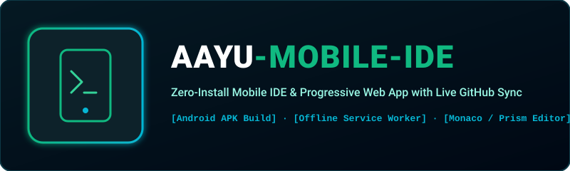
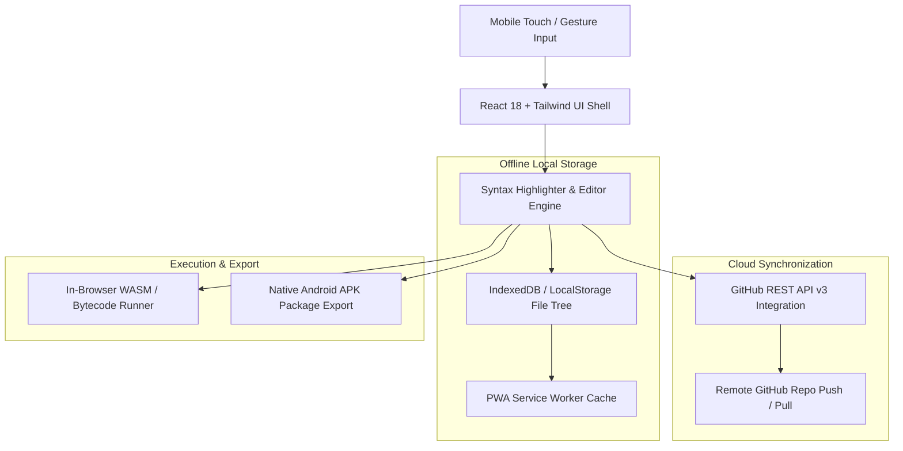

<p align="center">
  
</p>

<p align="center">
  <a href="https://github.com/Ghrit-igl/aayu-mobile-ide"></a>
  <a href="https://github.com/Ghrit-igl/aayu-mobile-ide"></a>
  <a href="https://github.com/Ghrit-igl/aayu-mobile-ide"></a>
  <a href="LICENSE"></a>
</p>

---

## 📱 What is AAYU Mobile IDE?

**AAYU Mobile IDE** is a mobile-first code editor and PWA development environment designed to run natively in mobile browsers, tablets, and Android APK containers.

### Key Capabilities:
1. **Touch-Optimized Code Editor**: High-speed syntax highlighting, line numbering, and bracket-matching tailored for virtual keyboards.
2. **Offline-First PWA Storage**: Service workers cache tutorials, libraries, and user source code locally in IndexedDB / localStorage.
3. **Live GitHub Synchronization**: Direct OAuth integration pulling and pushing commits to GitHub repositories without requiring a desktop git terminal.
4. **Standalone Android Packaging**: Easily wrapped into an Android APK using Capacitor / WebView toolchains.

---

## 🏛️ System Architecture



---

## 🚀 Quickstart

### 1. Install Dependencies
```bash
npm install
```

### 2. Start Local Development Server
```bash
npm run dev
```

### 3. Production Build
```bash
npm run build
```

---

## 📄 License
MIT License (c) 2026 Ayush Kaushik ([@Ghrit-igl](https://github.com/Ghrit-igl)).